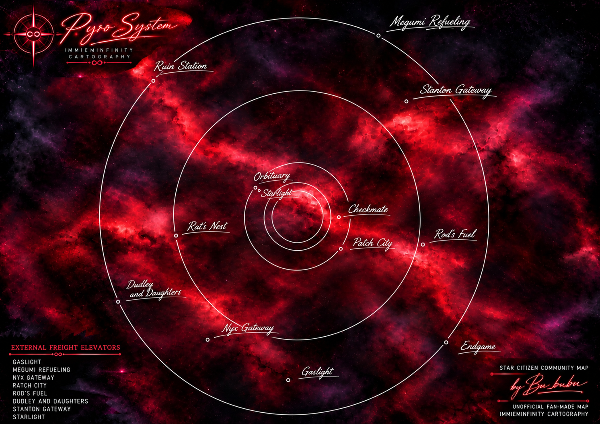

# Pyro System Cargo Map

### For Advanced Haulers — Star Citizen

An unofficial community cargo map of the Pyro system, designed for experienced haulers and players working with large-scale cargo operations.

The map shows the major stations and locations across Pyro, with special emphasis on locations equipped with **External Freight Elevators** — useful when planning routes and operating larger cargo ships.

## Full Map

**Click the map above to open it in full resolution.**

## External Freight Elevators

The map highlights locations with external freight elevators, allowing advanced haulers to quickly identify suitable cargo destinations and plan routes around their ship and cargo requirements.

## Credits

**Map & Cartography:** ImmiEminfinity Cartography  
**Community:** Star Citizen  
**Status:** Unofficial fan-made community map

---

*Star Citizen and related names, trademarks and game assets belong to their respective owners. This project is an unofficial community resource and is not affiliated with or endorsed by Cloud Imperium Games.*
